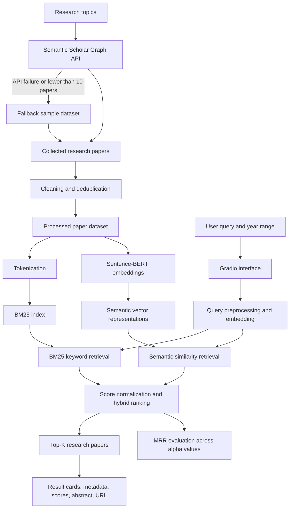

# Semantic Research Paper Retrieval Engine

A hybrid information retrieval application that helps users discover relevant research papers using **keyword-based search (BM25)** and **semantic similarity search (Sentence-BERT)**. The system collects paper metadata from the Semantic Scholar API, preprocesses and indexes paper titles and abstracts, combines retrieval scores, and presents ranked results through an interactive Gradio web interface.

## Table of Contents

- [Overview](#overview)
- [Key Features](#key-features)
- [System Architecture](#system-architecture)
- [Technology Stack](#technology-stack)
- [How Retrieval Works](#how-retrieval-works)
- [Project Workflow](#project-workflow)
- [Installation](#installation)
- [Running the Application](#running-the-application)
- [Using the Interface](#using-the-interface)
- [Evaluation](#evaluation)
- [Dataset and API](#dataset-and-api)
- [Project Structure](#project-structure)
- [Configuration](#configuration)
- [Limitations and Future Improvements](#limitations-and-future-improvements)
- [Troubleshooting](#troubleshooting)
- [License](#license)

## Overview

Finding research papers through keyword matching alone can miss relevant papers that use different terminology. Conversely, semantic search can identify conceptually related papers but may not give enough weight to exact technical terms. This project combines both approaches to improve retrieval.

The application searches papers across topics including:

- Deep learning
- Computer vision
- Natural language processing
- Generative AI
- Cybersecurity
- Anomaly detection
- Transformer models
- Reinforcement learning

For each paper, the application uses available metadata such as title, abstract, authors, publication year, venue, citation count, and paper URL. Search results include relevance scores and links to the paper record.

## Key Features

- **Automated paper collection:** Queries the Semantic Scholar Graph API for configured research topics.
- **Fallback dataset:** Uses a small predefined sample dataset if API collection fails or returns too few records.
- **Data cleaning:** Removes records with missing essential fields, empty abstracts, and duplicate paper IDs or titles.
- **Keyword retrieval:** Uses BM25 to match query terms against paper titles and abstracts.
- **Semantic retrieval:** Uses `sentence-transformers/all-MiniLM-L6-v2` to encode text into dense vector embeddings.
- **Hybrid ranking:** Combines normalized BM25 and semantic scores using a configurable weight.
- **Year filtering:** Restricts returned papers to a selected publication-year range.
- **Top-K selection:** Displays either 5 or 10 results.
- **Interactive interface:** Uses Gradio to collect queries and display ranked paper cards.
- **Retrieval evaluation:** Compares configurations using Mean Reciprocal Rank (MRR) and includes an optional NDCG import for ranking-quality evaluation.

## System Architecture

The application is organized into five main stages.



### Architecture Components


| Component | Responsibility |
|---|---|
| Data collection | Retrieves papers from Semantic Scholar for configured topics. |
| Fallback dataset | Supplies predefined sample records when collection is unsuccessful or insufficient. |
| Preprocessing | Cleans records, extracts author names, normalizes metadata, and removes duplicates. |
| BM25 index | Supports lexical retrieval using tokenized titles and abstracts. |
| Sentence-BERT encoder | Converts paper text and search queries into dense embeddings. |
| Hybrid retrieval | Combines keyword and semantic relevance scores. |
| Gradio interface | Accepts query parameters and renders ranked search results. |
| Evaluation | Measures ranking performance using the implemented MRR experiment. |

## Technology Stack

| Technology | Purpose |
|---|---|
| Python | Core application logic |
| Pandas | Dataset preparation and metadata management |
| NumPy | Numerical operations and score normalization |
| Requests | HTTP requests to the Semantic Scholar API |
| Sentence-Transformers | Text embeddings using `all-MiniLM-L6-v2` |
| PyTorch (via Sentence-Transformers) | Embedding tensor operations and similarity calculation |
| `rank_bm25` | BM25 lexical retrieval |
| scikit-learn | Imported for evaluation utilities |
| Matplotlib | Plots MRR against semantic weight |
| Gradio | Interactive web interface |

## How Retrieval Works

### 1. Data collection

The application queries the Semantic Scholar Graph API for each configured topic. It requests the paper ID, title, abstract, authors, year, URL, venue, and citation count. A delay is inserted between topic requests to reduce the likelihood of rate limiting.

If the API returns no records or fewer than 10 papers, the program switches to its predefined fallback dataset. The fallback contains sample paper records; it is not a complete or continuously updated research corpus.

### 2. Data preprocessing

The application converts author lists into readable strings, converts year and citation count fields to numeric values, fills missing venue and URL values, and removes records with missing paper IDs, titles, or abstracts. It then removes duplicate paper IDs and titles and resets the dataset index.

The cleaned dataset is saved locally as `papers.csv`. The title and abstract are concatenated into a text field used for retrieval.

### 3. BM25 keyword retrieval

BM25 is a lexical ranking method that scores documents according to query-term matches, taking term frequency and document length into account. In this project, each paper's title and abstract are tokenized using a lowercase word-tokenization function, then used to build a `BM25Okapi` index.

This component is useful for exact technical terms, named methods, acronyms, and specific phrases.

### 4. Semantic retrieval

The Sentence-BERT model `sentence-transformers/all-MiniLM-L6-v2` encodes each paper's combined title and abstract into a dense vector representation. The vectors are normalized and stored in memory. At query time, the search query is encoded in the same embedding space, and dot-product similarity is used to estimate semantic relevance.

Semantic retrieval can find conceptually related papers even when the query and paper use different wording.

### 5. Score normalization and hybrid ranking

The implementation independently min-max normalizes the BM25 and semantic score arrays, then combines them using the configurable semantic weight \(\alpha\):

\[
S_{\text{hybrid}}(q,d)=
\alpha S_{\text{semantic}}(q,d)
+(1-\alpha)S_{\text{BM25}}(q,d)
\]

where:

- \(q\) is the user query.
- \(d\) is a candidate paper.
- \(S_{\text{semantic}}\) is the normalized semantic similarity score.
- \(S_{\text{BM25}}\) is the normalized lexical score.
- \(\alpha\) is the semantic weight between 0 and 1.

The default value is **0.7**, which assigns 70% weight to semantic similarity and 30% to BM25. A higher value emphasizes semantic matching; a lower value emphasizes keyword matching. Results are sorted by the hybrid score and truncated to the requested Top-K count.

**Implementation note:** The current code calculates BM25 and semantic scores over the full corpus before applying the publication-year filter to returned candidates. Consequently, score normalization is based on the full corpus rather than only the year-filtered subset.

## Project Workflow

1. Configure research topics and API request fields.
2. Fetch paper records from Semantic Scholar, or load the fallback records when necessary.
3. Clean and deduplicate records and save the resulting dataset to `papers.csv`.
4. Tokenize titles and abstracts and build the BM25 index.
5. Load Sentence-BERT and generate normalized paper embeddings.
6. Accept a query, minimum year, maximum year, Top-K count, and semantic weight.
7. Run lexical and semantic retrieval and combine the normalized scores.
8. Display ranked results with metadata, abstract snippets, relevance scores, and paper links.
9. Run the MRR experiment to compare selected semantic-weight values.

## Installation

### Prerequisites

- Python 3.9 or later is recommended.
- Internet access is needed for API collection and the initial model download.
- Enough memory to load the embedding model and retain the paper embeddings.

Create and activate a virtual environment:

**Windows (PowerShell)**

```powershell
python -m venv .venv
.\.venv\Scripts\Activate.ps1
```

**Linux or macOS**

```bash
python3 -m venv .venv
source .venv/bin/activate
```

Install dependencies:

```bash
pip install sentence-transformers rank_bm25 gradio pandas numpy requests scikit-learn matplotlib
```

## Running the Application

Save the application code in a Python file, for example `app.py`, then run:

```bash
python app.py
```

The program collects the dataset, builds the retrieval indexes and embeddings, runs the configured evaluation, and launches the Gradio interface. The code currently uses:

```python
demo.launch(share=True, debug=False)
```

With `share=True`, Gradio may create a temporary public URL. Use this only when appropriate for your data and environment; do not expose private datasets or sensitive information. For local-only access, change it to:

```python
demo.launch(share=False, debug=False)
```

The first run can take longer because the model may need to be downloaded and embeddings generated.

## Using the Interface

1. Enter a research query, such as `deep neural networks for vision`.
2. Choose the minimum and maximum publication years.
3. Select Top-K as 5 or 10.
4. Adjust the semantic weight \(\alpha\) from 0.0 to 1.0.
5. Submit the query and inspect the ranked papers.

Each result card displays the paper title, available authors, year, citation count, hybrid score, semantic score, BM25 score, an abstract snippet, and a link to the paper.

## Evaluation

The code defines three evaluation queries:

- `deep neural networks for vision`
- `attention mechanism`
- `malware detection`

It creates a simple reference set for each query using the top BM25 results, then evaluates hybrid retrieval for semantic weights \(\alpha \in \{0.3, 0.5, 0.7, 0.8\}\). The plot titled **Alpha vs MRR** shows how Mean Reciprocal Rank changes across those settings.

Mean Reciprocal Rank measures the rank of the first retrieved item that appears in the reference set:

\[
\mathrm{MRR}=\frac{1}{|Q|}
\sum_{q \in Q}\frac{1}{\mathrm{rank}_q}
\]

Here, \(\mathrm{rank}_q\) is the rank of the first relevant retrieved paper for query \(q\); if no relevant item is retrieved, its reciprocal rank is zero.

**Evaluation caveat:** The current reference sets are generated from BM25's own top results, so the evaluation measures agreement with a BM25-derived reference rather than independent human relevance judgments. It should not be interpreted as a definitive measure of real-world search quality. Although `ndcg_score` is imported, the provided code does not currently calculate or display NDCG.

## Dataset and API

**API endpoint**

```text
https://api.semanticscholar.org/graph/v1/paper/search
```

**Requested fields:** `paperId`, `title`, `abstract`, `authors`, `year`, `url`, `venue`, and `citationCount`.

The number of papers requested per topic is configured as 25. Actual results depend on API availability, query behavior, and rate limits. The cleaned local dataset is written to `papers.csv`.

Follow Semantic Scholar's current API documentation and usage policies for rate limits, attribution, and permitted use. API access and returned fields may change.

## Project Structure

A recommended repository layout is:

```text
semantic-research-paper-retrieval/
├── app.py                 # Main application and Gradio interface
├── papers.csv              # Generated cleaned dataset
├── requirements.txt        # Python dependencies
├── README.md               # Project documentation
└── .gitignore              # Files excluded from version control
```

`papers.csv` is generated when the application runs. Depending on your repository setup, you may choose to exclude it from version control and regenerate it as needed.

### Example `requirements.txt`

```text
sentence-transformers
rank_bm25
gradio
pandas
numpy
requests
scikit-learn
matplotlib
```

## Configuration

The main settings are defined near the start of the code:

```python
TOPICS = [
    "deep learning",
    "computer vision",
    "natural language processing",
    "generative AI",
    "cybersecurity",
    "anomaly detection",
    "transformer models",
    "reinforcement learning",
]

PAPERS_PER_TOPIC = 25
DELAY_BETWEEN_REQUESTS = 4.0
MODEL_NAME = "sentence-transformers/all-MiniLM-L6-v2"
DEFAULT_ALPHA = 0.7
```

`MODEL_NAME` and `DEFAULT_ALPHA` are shown here as recommended configuration names; the supplied code currently uses the model name directly and sets the default alpha in the interface and search function. If you introduce these variables, update the corresponding references in the code.

## Limitations and Future Improvements

- **Persistent vector index:** Paper embeddings currently reside in memory. A vector database or approximate-nearest-neighbor index could improve scalability for larger collections.
- **Efficient year filtering:** Filter candidate documents before ranking or use a filtered index to reduce unnecessary scoring.
- **Robust API handling:** Add explicit timeouts, retry/backoff for rate limits and transient failures, and structured logging.
- **Model and index caching:** Persist embeddings and indexes so the model does not need to encode the full corpus on every application startup.
- **Improved evaluation:** Use independently labeled relevance judgments, more queries, and metrics such as NDCG@K, Recall@K, and Precision@K.
- **Metadata quality:** Validate missing abstracts, invalid URLs, and inconsistent publication years.
- **Duplicate detection:** Add fuzzy title matching or DOI-based deduplication where DOI metadata is available.
- **Production deployment:** Add request validation, monitoring, authentication where needed, and resource limits before exposing the service publicly.
- **Security and reliability:** Escape or sanitize external metadata before rendering HTML, and add timeouts and error handling to API requests.

## Troubleshooting

**The API returns an error or too few papers.**  
Check connectivity and API availability, review the returned HTTP status, and respect rate limits. The program uses the fallback dataset when no records or fewer than 10 records are collected.

**The first launch is slow.**  
The Sentence-BERT model must be loaded and paper embeddings generated. Persisting embeddings and indexes can reduce repeated startup work.

**No results are displayed.**  
Check that the query is not empty, the year range includes records in `papers.csv`, and the dataset contains non-empty abstracts.

**A public Gradio link is not needed.**  
Set `share=False` in `demo.launch()` to keep the interface local.

## License

No license is specified in the supplied project code. Add a `LICENSE` file before distributing the project, and verify the usage terms for dependencies, the Sentence-Transformers model, and data obtained from Semantic Scholar.


